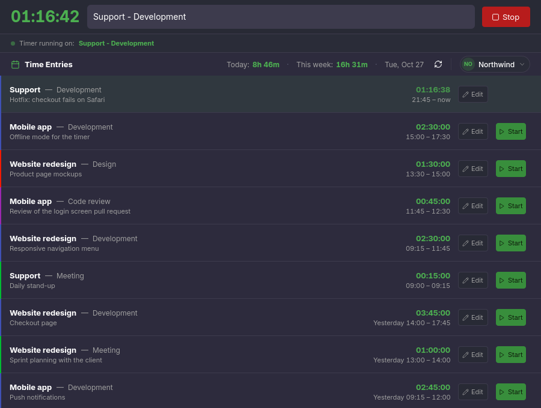
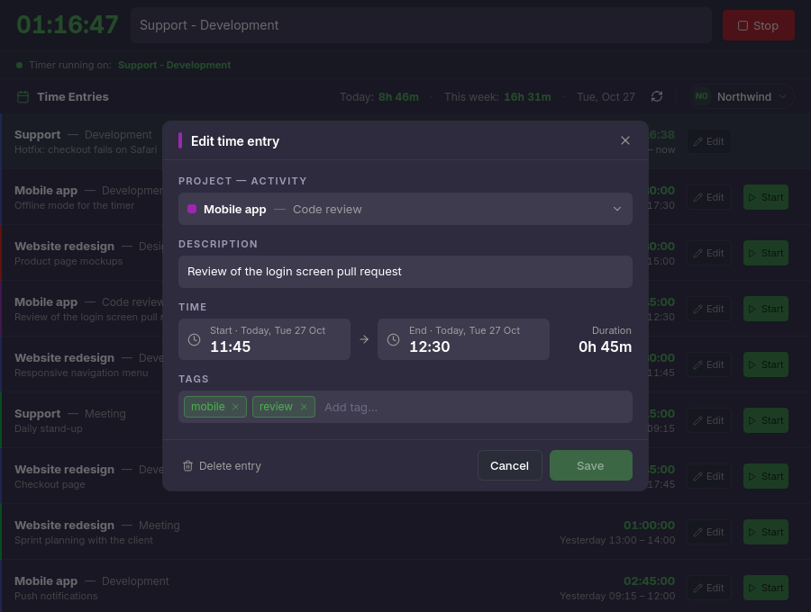
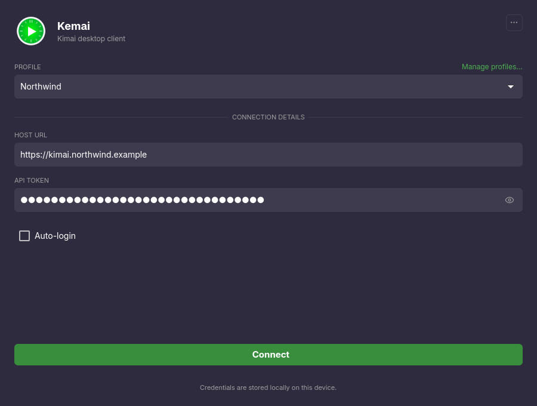

# Kemai

**A desktop client for [Kimai](https://www.kimai.org/), the open source time-tracking application.**
Start and stop your timer, correct your recent entries and see what is running from the system tray, without opening a browser.

[](https://github.com/AlexandrePTJ/kemai/actions/workflows/main.yml)
[](LICENSE.txt)
[](https://github.com/AlexandrePTJ/kemai/releases)

Windows, macOS and Linux. Free software under the [MIT license](LICENSE.txt), developed independently of the Kimai project.



> [!IMPORTANT]
> **Kemai is being rewritten** (Qt 6 / QML, `develop` branch), published as **alpha** releases, source only for now.
> The stable version is **0.11.1** (`master` branch); it no longer receives changes.

## Features

- **Timer**: start on a project and activity, or restart a recent entry; stop it from the window or the tray.
- **History**: entries of this week, this month or the last 30 days; edit or delete any of them.
- **Quick creation** of a customer, project or activity from the search.
- **Tasks** from the Kimai *Task Management* plugin, and required **custom fields** (*MetaFieldsBundle*).
- **In sync** with the web interface and other clients.
- **Away detection** (optional): stop the timer when you are idle or lock your session, at the time you left.
- **Several servers**: saved profiles, tokens in the system keychain; self-signed certificates trusted per server.

The interface is in English only for now.

<p>
  
  
</p>

## Installation

You need a Kimai **2.14 or later** server and an **API token** (Kimai › your profile › *API access*).

- **Stable (0.11.1)**: download your system's package from the [latest release](https://github.com/AlexandrePTJ/kemai/releases/latest), or on macOS `brew tap alexandreptj/cask && brew install kemai`.
- **Alpha**: [pre-releases](https://github.com/AlexandrePTJ/kemai/releases) named `YY.MONTH.PATCH` (`26.10.1`). Build them from source (below); each release's notes give the exact commands. Signed Windows packages and a [Flathub](https://flathub.org) package (`io.github.AlexandrePTJ.Kemai`) are on the way; a release's notes say when it has them.

The rewrite runs next to Kemai 0.11 without touching its settings, and offers to import its profiles at the first start.

## Using Kemai

On the login screen, enter your server's address (`https://` is assumed) and your token, and save them as a profile if you like. Then pick a project and an activity and start the timer.

Settings are in the account menu (and on the login screen):

- **Inactivity**: stop the timer after some idle time, or when the session locks. Idle time is not available on Wayland desktops other than GNOME and KDE Plasma, nor session lock in the Flatpak; the setting then says why.
- **Window**: close or minimize to the tray. On GNOME, the tray icon needs the [AppIndicator](https://extensions.gnome.org/extension/615/appindicator-support/) extension.
- **Trusted certificates**: those you accepted for a self-hosted server, after checking their fingerprint.
- **Updates**: the check for a newer version of your channel. Kemai only links to the release; it never downloads anything.

## Your data and privacy

- API tokens stay in the system keychain, never in a file or in the logs.
- Profiles and settings are JSON files in your user configuration folder; logs (3 × 5 MB at most) are shown by *Log journal…*.
- Kemai connects only to your Kimai server and, for the update check you can turn off, to GitHub's public API. No telemetry.

## Code signing policy

Windows packages are signed for free: code signing by [SignPath.io](https://about.signpath.io/), certificate by [SignPath Foundation](https://signpath.org/). Only Kemai's own files (`Kemai.exe`, the installer) are signed, built from this repository by its release workflow; the Qt libraries and the Visual C++ runtime next to them are third-party components.

- Committers, reviewers and approvers: [Alexandre Petitjean](https://github.com/AlexandrePTJ). Every other contribution is reviewed before it is merged, workflows included, and every signing request is approved by hand.
- Privacy: see [Your data and privacy](#your-data-and-privacy).

## Build from source

You need CMake 3.30+, Ninja, a C++20 compiler (GCC or Clang, Visual Studio 2022, Xcode command line tools) and Qt 6.11+ ([online installer](https://www.qt.io/download-qt-installer-oss) or [aqtinstall](https://github.com/miurahr/aqtinstall)). On Linux, also libsecret's development files (`libsecret-1-dev`, `libsecret-devel`, `libsecret`), and optionally `libxcb-screensaver0-dev` for idle time on other X11 desktops. The other dependencies are downloaded by CMake.

```shell
git clone https://github.com/AlexandrePTJ/kemai.git
cd kemai
cmake --preset release -DCMAKE_PREFIX_PATH=<Qt dir>/6.11.3/<gcc_64|msvc2022_64|macos>
cmake --build --preset release
cmake --install build/release --prefix <target dir>   # optional: self-contained copy, Qt included
```

On Windows, run them from an *x64 Native Tools Command Prompt for VS 2022*. The app is `build/release/bin/Kemai` (`.exe`, `.app`).

To build a release, check out its tag and add `-DKEMAI_VERSION=<version> -DKEMAI_CHANNEL=<alpha|stable>`; otherwise Kemai is a development build (`dev-<commit>`) and never checks for updates.

Packagers: `-DKEMAI_ENABLE_UPDATE_CHECK=OFF` (no update check), `-DKEMAI_DEPLOY_QT=OFF` (install without Qt), `-DKEMAI_BUILD_LOCAL_DEPENDENCIES=OFF` (use the installed spdlog, fmt, magic_enum and qtkeychain; add `-DBUILD_TESTING=OFF` without Catch2).

## Help and contributing

Questions go to [Discussions](https://github.com/AlexandrePTJ/kemai/discussions), bugs to [issues](https://github.com/AlexandrePTJ/kemai/issues) — with your Kemai version (*About Kemai*), system, Kimai version and the relevant lines of the *Log journal*.

Contributions are welcome: read [CONTRIBUTING.md](CONTRIBUTING.md) and the [Code of Conduct](CODE_OF_CONDUCT.md). Translations of 0.11.x are on [Weblate](https://hosted.weblate.org/engage/kemai/).

## License

[MIT](LICENSE.txt), © 2020–2026 Alexandre Petitjean. Third-party components are listed with their licenses in *About Kemai*.

Why "Kemai"? Because "Il n'y a que Maille qui m'aille".
