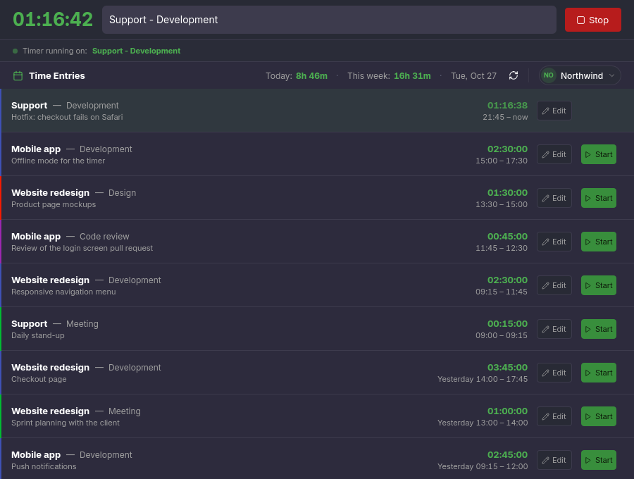
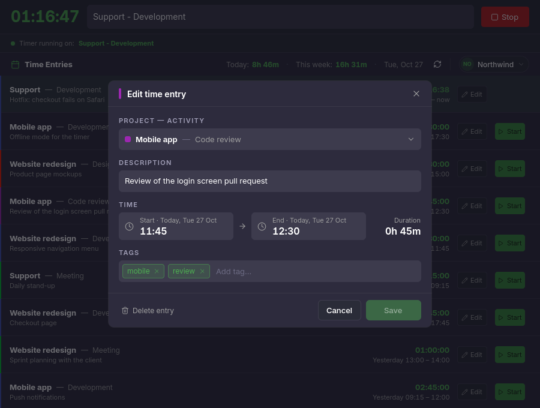
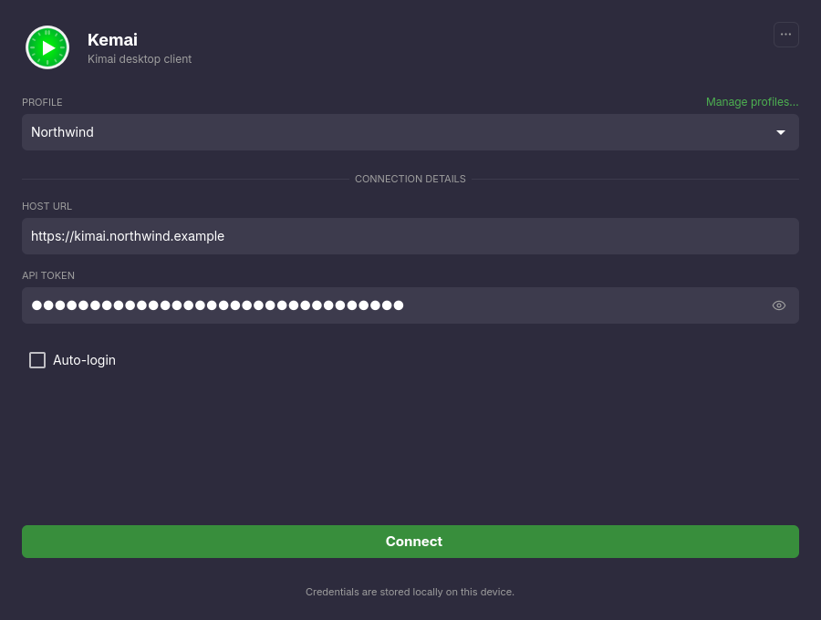

# Kemai

**A desktop client for [Kimai](https://www.kimai.org/), the open source time-tracking application.**
Start and stop your timer, review and correct your recent entries, and see what is running from your system tray, without opening a browser.

[](https://github.com/AlexandrePTJ/kemai/actions/workflows/main.yml)
[](LICENSE.txt)
[](https://github.com/AlexandrePTJ/kemai/releases)

Kemai runs on Windows, macOS and Linux. It is free software under the [MIT license](LICENSE.txt), developed independently of the Kimai project.



> [!IMPORTANT]
> **Kemai is being rewritten.** The `develop` branch holds a complete rewrite (Qt 6 / QML), published as **alpha** releases, **source only**.
> The current stable version is **0.11.1** (`master` branch). Bugs and feature requests are now addressed in the rewrite, not in 0.11.x.

## Contents

- [Features](#features)
- [Requirements](#requirements)
- [Installation](#installation)
- [Getting started](#getting-started)
- [Using Kemai](#using-kemai)
- [Your data and privacy](#your-data-and-privacy)
- [Code signing policy](#code-signing-policy)
- [Build from source](#build-from-source)
- [Getting help](#getting-help)
- [Contributing](#contributing)
- [License](#license)

## Features

The rewrite (alpha) offers:

- **Timer**: start a timer on a project and activity, or restart one of your recent entries; stop it from the window or from the tray.
- **History**: your recent time entries grouped by day; edit or delete any of them (project, activity, description, start, end, tags).
- **Quick creation**: create a customer, project or activity straight from the search when it does not exist yet.
- **Tasks**: list, start and close your open tasks when the Kimai *Task Management* plugin is installed.
- **Always in sync**: a timer started, stopped or edited in the web interface or another client shows up in Kemai.
- **Away detection** (optional): stop the timer when you are idle or lock your session, at the time you actually left.
- **System tray**: see whether a timer runs and for how long, and stop it, from the tray icon.
- **Several Kimai servers**: saved connection profiles, with tokens kept in your system's keychain.
- **Self-hosted servers**: trust a self-signed certificate for one server, after checking its fingerprint.
- **Update notice**: Kemai tells you when a newer version is published and links to its release page. It never downloads or installs anything.

Not available yet in the rewrite: translations (the interface is in English).

<p>
  
  
</p>

## Requirements

- A Kimai server, version **2.14 or later**, and an account on it.
- An **API token** for that account (see [Getting started](#getting-started)). Logging in with a username and an API password is no longer supported.
- Windows, macOS or Linux, 64-bit.

## Installation

### Stable version (0.11.1)

Ready-to-use packages are available on the [latest release](https://github.com/AlexandrePTJ/kemai/releases/latest) page: download the file for your system.

Files with the `-NoUpdate` suffix never check for updates. They are meant for system package managers.

On macOS, Kemai 0.11.1 can also be installed with [Homebrew](https://brew.sh/):

```shell
brew tap alexandreptj/cask
brew install kemai
```

### Rewrite (alpha)

Alpha releases are listed as *pre-releases* on the [Releases](https://github.com/AlexandrePTJ/kemai/releases) page and named after their date: `YEAR.MONTH.PATCH`, for example `2026.10.1`.

So far they are **source only**: Kemai never publishes unsigned programs, which would trigger security warnings on Windows and macOS. Build Kemai as described in [Build from source](#build-from-source); each release's notes give the exact commands for that release.

**Windows.** Signed Windows packages are being prepared (see the [code signing policy](#code-signing-policy)). When a release offers one, its notes say so and `Kemai-<version>-windows-x64.zip` is attached to it:

1. Download the ZIP and unzip it anywhere, for example in your user folder.
2. Run `Kemai.exe` in the `bin` folder. Nothing is installed and no administrator rights are needed.
3. To remove Kemai, delete the folder. Your settings stay in your user configuration folder (see [Your data and privacy](#your-data-and-privacy)).

`Kemai.exe` is signed: Windows shows **SignPath Foundation** as its publisher. Right after a release, Windows SmartScreen may still warn about a file it has not seen often yet; *More info* then shows the publisher before you choose to run it.

**Linux.** Kemai is being prepared for [Flathub](https://flathub.org), which builds it from each release's source for every distribution. Once it is published there, stable releases install with `flatpak install flathub io.github.AlexandrePTJ.Kemai`, and alphas from Flathub's beta repository:

```shell
flatpak remote-add --if-not-exists flathub-beta https://flathub.org/beta-repo/flathub-beta.flatpakrepo
flatpak install flathub-beta io.github.AlexandrePTJ.Kemai
```

Flathub delivers the updates, so this Kemai does not check for new versions itself. It runs in a sandbox: its profiles and settings are kept apart from those of a Kemai built from source or of Kemai 0.11.x (whose profiles it cannot import), and stopping the timer when the session is locked is not available (stopping it when you are idle is).

The rewrite can be installed next to Kemai 0.11.x. Each keeps its own settings and the rewrite never modifies those of 0.11.x; it offers to import 0.11.x's profiles (see [Coming from Kemai 0.11](#coming-from-kemai-011)).

## Getting started

1. **Create an API token in Kimai.** In Kimai's web interface, open your user profile, then *API access*, and create a token.
2. **Log in from Kemai.** On the login screen, enter your Kimai server's address (for example `kimai.example.com`; `https://` is used when no scheme is given) and the token.
3. **Keep a profile** (optional). Save the server and token as a profile to log in again without typing them. Several profiles can be saved, one per server or account.

Once logged in, pick a project and an activity in the timer bar and start the timer. Your recent entries are listed below it.

### Coming from Kemai 0.11

When Kemai 0.11 is installed on the same computer, the login screen offers to import its profiles: their names, server addresses and API tokens, which move to your system's keychain. Nothing else is imported (preferences, trusted certificates), and Kemai 0.11's own settings are left untouched. A profile that only has the old API password of Kemai 0.11 is not imported: create an API token in Kimai and add that profile by hand. If you decline the import for good, profiles can still be created by hand.

## Using Kemai

### Settings

Settings are opened from the account menu (your account name, above the history: *Settings…*) or from the login screen. Every change applies at once.

### Stopping the timer when you are away

In *Settings › Inactivity*, Kemai can stop the running timer after a chosen time without keyboard or mouse activity, or when your session is locked. The entry then ends when you left, not when Kemai noticed it, and a notice tells you when you come back.

Where this is available:

| | Idle time | Session lock |
|---|---|---|
| Windows | yes | yes |
| macOS | yes | yes |
| Linux, GNOME or KDE Plasma | yes | yes (logind) |
| Linux, other X11 sessions | yes | yes (logind) |
| Linux, other Wayland desktops | no | yes (logind) |

When a source is missing, the setting is disabled and Kemai says why.

### System tray

While Kemai runs, its tray icon (the Windows notification area, the macOS menu bar, the Linux system tray) shows whether a timer is running; its tooltip gives the project, activity and duration.

- **Click** the icon to bring the window to the front, or to hide it when it already is.
- Its **menu** shows the window, stops the running timer, or quits Kemai. Quitting never stops a timer: it keeps running on your Kimai server.
- In *Settings › Window*, **Close to tray** and **Minimize to tray** keep Kemai in the tray instead of quitting or staying in the taskbar. Both are off by default.

On Windows, a new icon first appears among the hidden icons (`^`): drag it to the taskbar to keep it in view.
On Linux, the icon needs a desktop that shows tray icons (StatusNotifierItem). KDE Plasma, XFCE, Cinnamon and most others do; GNOME needs the [AppIndicator and KStatusNotifierItem Support](https://extensions.gnome.org/extension/615/appindicator-support/) extension. Without it, Kemai shows no icon and closing the window quits it.

### Self-signed certificates

Kemai works with self-hosted servers whose certificate is self-signed or issued by a private authority. At the first connection, Kemai shows the certificate's **fingerprint** and lets you trust **this certificate, for this server only**. Compare the fingerprint with the one your administrator gives you or your browser shows before trusting it.

Trusted certificates are listed, and can be removed, in *Settings › Trusted certificates*. If the server's certificate changes, Kemai asks again. An expired certificate, or one issued for another name, is always refused.

### Updates

Kemai checks at start whether a newer version of your channel (stable or alpha) has been published, and shows a notice linking to its release page. You can ignore a version, check on demand from the account menu, or turn the check off in *Settings › Updates*.

## Your data and privacy

- **Your API tokens** are stored in your system's keychain (Windows Credential Manager, macOS Keychain, the Secret Service on Linux), never in a plain file and never in the logs.
- **Profiles and settings** are stored as JSON files in your user configuration folder.
- **Logs** are written for troubleshooting (three files of at most 5 MB, the oldest are deleted). They contain no token. *Log journal…* in the account menu shows them and opens their folder.
- **Network**: Kemai connects to your Kimai server, and to GitHub's public API to check for a new version (no account or personal data is sent; turn it off in *Settings › Updates*). There is no telemetry, analytics or tracking of any kind.

## Code signing policy

Windows packages of Kemai are signed for free: free code signing provided by [SignPath.io](https://about.signpath.io/), certificate by [SignPath Foundation](https://signpath.org/).

- Committers and reviewers: [Alexandre Petitjean](https://github.com/AlexandrePTJ). Contributions from anyone else are reviewed before they are merged, workflows and build scripts included.
- Approvers: [Alexandre Petitjean](https://github.com/AlexandrePTJ). Every signing request is approved by hand.

Only `Kemai.exe`, built from this repository by its GitHub Actions release workflow, is signed. The Qt libraries and the Visual C++ runtime shipped next to it are third-party components, under their own licenses and signatures.

Privacy: Kemai sends nothing to anyone but your Kimai server and, for the update check that you can turn off, GitHub. See [Your data and privacy](#your-data-and-privacy).

## Build from source

Requirements, on every platform:

- CMake 3.30 or later and Ninja
- A C++20 compiler: GCC or Clang on Linux, Visual Studio 2022 on Windows, the Xcode command line tools on macOS
- Qt 6.11 or later (desktop, base install), from the [Qt online installer](https://www.qt.io/download-qt-installer-oss) or [aqtinstall](https://github.com/miurahr/aqtinstall), for example `aqt install-qt linux desktop 6.11.3 linux_gcc_64` (on Windows, Qt 6.11 needs an aqtinstall newer than 3.3.0, or the online installer)
- On Linux, the Secret Service development files, used to store API tokens in the system keychain: `libsecret-1-dev` on Debian/Ubuntu, `libsecret-devel` on Fedora, `libsecret` on Arch. Optionally the X11 screensaver extension (`libxcb-screensaver0-dev` on Debian/Ubuntu) for idle time in X11 sessions outside GNOME and KDE.

The other dependencies (spdlog, fmt, magic_enum, qtkeychain, Catch2) are downloaded by CMake during configuration.

```shell
git clone https://github.com/AlexandrePTJ/kemai.git
cd kemai
cmake --preset release -DCMAKE_PREFIX_PATH=<Qt install dir>/6.11.3/<arch>
cmake --build --preset release
```

`<arch>` is `gcc_64` on Linux, `msvc2022_64` on Windows and `macos` on macOS. On Windows, run these commands from an *x64 Native Tools Command Prompt for VS 2022*.

The application is built as `build/release/bin/Kemai` (`Kemai.exe` on Windows, `Kemai.app` on macOS). To get a self-contained copy, with the Qt libraries it needs next to it, run:

```shell
cmake --install build/release --prefix <target dir>
```

**Building a given release.** Check out its tag and pass its version and channel, as given in its release notes:

```shell
git checkout 2026.10.1
cmake --preset release -DCMAKE_PREFIX_PATH=<...> -DKEMAI_VERSION=2026.10.1 -DKEMAI_CHANNEL=alpha
cmake --build --preset release
```

Without them, Kemai reports itself as a development build (`dev-<commit>`) and does not check for updates.

**For packagers.**

- `-DKEMAI_ENABLE_UPDATE_CHECK=OFF` builds Kemai without the update check, for distributions that deliver updates themselves.
- `-DKEMAI_DEPLOY_QT=OFF` makes `cmake --install` install only Kemai's own files, without copying Qt next to it, when Qt comes from the system or a runtime.
- `-DKEMAI_BUILD_LOCAL_DEPENDENCIES=OFF` uses the installed spdlog, fmt, magic_enum and qtkeychain instead of downloading them (tests then need `-DBUILD_TESTING=OFF` or an installed Catch2).
- On Linux, the install also puts the desktop entry, the icon and the AppStream metadata in `share/`, named after the app ID `io.github.AlexandrePTJ.Kemai`.

## Getting help

- **Questions and help**: use [GitHub Discussions](https://github.com/AlexandrePTJ/kemai/discussions).
- **Bugs**: open an [issue](https://github.com/AlexandrePTJ/kemai/issues). Please give your Kemai version (*About Kemai* in the account menu), your system, your Kimai version, and what you expected. The *Log journal* can copy the relevant log lines for you; they contain no token, but check them for server names or project names you would rather not share.

## Contributing

Contributions are welcome: bug reports, ideas, documentation and code. Please read [CONTRIBUTING.md](CONTRIBUTING.md) before opening a pull request; new work starts from the `develop` branch. Everyone taking part follows the [Code of Conduct](CODE_OF_CONDUCT.md).

Translations of Kemai 0.11.x are managed on [Weblate](https://hosted.weblate.org/engage/kemai/). The rewrite is not translatable yet.

[](https://hosted.weblate.org/engage/kemai/)

## License

Kemai is released under the [MIT license](LICENSE.txt). © 2020–2026 Alexandre Petitjean.

It is built with Qt and other open source components, each under its own license; *About Kemai* lists them with their licenses. Kimai is a separate project by its own authors.

## Why "Kemai"

Because "Il n'y a que Maille qui m'aille".
